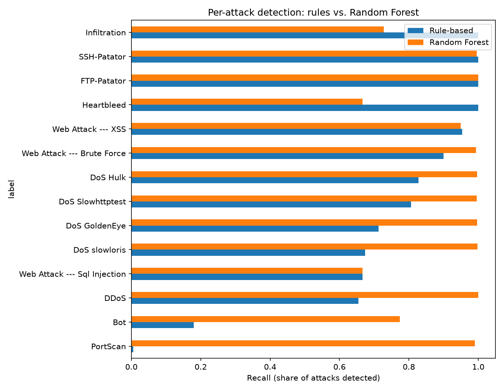

# AI Network Intrusion Detection System

Rule-based vs. machine-learning detection of malicious network traffic on the CICIDS2017 dataset, with a robustness stress test that simulates attacker evasion.

Built as a security-focused portfolio project: the goal is to measure what machine learning adds over traditional threshold rules from a SOC analyst's point of view (missed attacks, false alarms, and where each approach breaks), not to chase a leaderboard score.

## Threat model

- **What is detected:** malicious network flows (14 attack types in CICIDS2017, including DoS/DDoS, port scans, brute force, web attacks and botnet traffic) versus benign flows, using flow-level statistics (packet sizes, counts, timing, flags).
- **Attacker assumption for the evasion test:** the attacker controls only their own traffic, so they can change packet sizes, packet counts and timing. They cannot change the destination port or the server's replies. In this test the attacker has no access to the model and computes no gradients; the perturbation is random.
- **Out of scope:** encrypted payload inspection, training-data poisoning, live deployment, and optimized (gradient-based or GAN-based) evasion attacks.

## Key results

All results are on the same held-out test set: 749,394 flows, of which 127,718 (17.04%) are attacks. They come from one run in Python 3.12.2 with numpy 2.5.4, pandas 3.1.0 and scikit-learn 1.9.1 (see "Run-to-run variability" below).

| Detector | Precision | Recall | F1 | Missed attacks | False alarms |
|---|---|---|---|---|---|
| Always predict benign | 0.0000 | 0.0000 | 0.0000 | 127,718 | 0 |
| Rule-based (2 hand-written rules) | 0.3558 | 0.5968 | 0.4458 | 51,498 | 138,002 |
| Logistic Regression | 0.8808 | 0.8615 | 0.8710 | 17,687 | 14,895 |
| Decision Tree | 0.9959 | 0.9952 | 0.9956 | 607 | 526 |
| Random Forest (50 trees) | 0.9964 | 0.9954 | 0.9959 | 592 | 457 |
| Gradient Boosting | 0.9962 | 0.9983 | 0.9972 | 214 | 492 |
| Soft vote (RF + GB) | 0.9966 | 0.9981 | 0.9974 | 247 | 430 |
| Flag if either RF or GB flags | 0.9954 | 0.9990 | 0.9972 | 133 | 596 |

The "always predict benign" row is the accuracy trap: because 83% of traffic is benign, that model scores about 83% accuracy while detecting nothing. Accuracy is never used to compare models here.

On clean data, Gradient Boosting is the best single model (214 missed attacks versus 592 for the Random Forest at similar precision).



## Evasion stress test

Attack flows in the test set were perturbed in three ways an attacker could plausibly achieve by changing how traffic is sent: padding or trimming packets, sending more or fewer packets, and slowing down or speeding up. Each flow's features are rescaled by a random factor within the stated range, with related features moved together. Benign flows were not perturbed. The table shows the share of attacks still detected.

| Detector | Clean | ±25% | ±50% | ±90% |
|---|---|---|---|---|
| Rule-based | 0.5968 | 0.5689 | 0.5427 | 0.4535 |
| Logistic Regression | 0.8615 | 0.8155 | 0.7638 | 0.7288 |
| Decision Tree | 0.9952 | 0.9018 | 0.8404 | 0.8127 |
| Random Forest | 0.9954 | 0.9934 | 0.9527 | 0.9038 |
| Gradient Boosting | 0.9983 | 0.9519 | 0.9487 | 0.8835 |
| Soft vote (RF + GB) | 0.9981 | 0.9914 | 0.9850 | 0.9203 |
| Flag if either flags | 0.9990 | 0.9983 | 0.9970 | 0.9655 |

Findings:

- **Clean-data scores hid real differences.** The Decision Tree and Random Forest are almost identical on clean data (F1 0.9956 vs 0.9959) but about 11 points apart at ±50% (0.8404 vs 0.9527).
- **Which of Random Forest and Gradient Boosting is more robust is not settled.** In this run the Random Forest is slightly ahead (5 perturbation seeds: 0.9526 ± 0.0005 vs 0.9481 ± 0.0004 at ±50%; 0.9035 ± 0.0007 vs 0.8831 ± 0.0006 at ±90%). An earlier run of the same experiment, on a different machine with different library versions (scikit-learn 1.7.2, pandas 2.3.3), had Gradient Boosting ahead (0.9804 vs 0.9498 at ±50%). The seed repeats vary only the perturbation, not the training, so they cannot detect this kind of difference. The cause was not isolated.
- **Each model fails on a different attack type, in both runs.** Under ±50% perturbation, the Random Forest's PortScan recall drops from 0.990 to 0.823, while Gradient Boosting's PortScan recall stays at 1.000 and its DDoS recall drops from 1.000 to 0.837 (0.943 in the earlier run). Because the two models' mistakes only partly overlap, combining them helps.
- **The ensemble result held in both runs.** Flagging a flow when either model flags it was the most robust detector both times (0.9970 here and 0.9973 earlier at ±50%; 0.9655 and 0.9666 at ±90%).
- **Single overall numbers hide this.** Both models look robust in aggregate while each has one attack class that degrades badly.

Read these as a lower bound on vulnerability, not a measure of real-world attacker capability (see Limitations).

## Rules vs. machine learning

- **Rules:** two hand-written rules chosen using the training set only: (1) destination port is 21 or 22, or (2) flow lasts over one second with at least three forward packets. Two other plausible rules (tiny non-DNS probes, high packet rate) were tested and rejected because their precision was no better than random on training data. A textbook "high packet rate means flood" rule flagged more benign flows than attacks here, because short benign flows such as DNS also have very high packet rates.
- **What rules do well:** they are transparent ("flagged because the flow lasted over a second"), need no training data, and catch FTP and SSH brute force at 100% (though by flagging every flow to those ports, which accounts for part of their false alarms).
- **Where rules fail:** port scans (0.6% recall) and botnet traffic (18% recall), and they miss about 87 times as many attacks as the Random Forest. Anyone who knows the thresholds can also defeat rule 2 deterministically by keeping flows under one second, whereas defeating an ML model requires knowing or probing it.
- **Operating point:** a missed attack costs more than an extra alert in a SOC, so the recommended configuration is "flag if either model flags": it misses 133 attacks versus 214 for Gradient Boosting alone, at the price of 104 more false alarms, and it held up best under perturbation in both runs. Teams suffering alert fatigue could reasonably choose soft vote or Gradient Boosting alone. This is a judgement about costs, and the two combination rules were fixed in advance, not tuned on the test set.

## Method

- **Data:** the CIC-IDS2017 `MachineLearningCSV` files (8 day/session files, 78 flow features plus a label). Rows with missing or infinite values were dropped and exact duplicates removed (across all files), leaving 2,497,980 flows (15 labels, 17.04% attack).
- **Split:** one fixed 70/30 split, stratified on the full attack label so rare attacks appear in both sets, with seed 42. All detectors are trained and scored on this same split. `Label`, `Day` and the binary target are excluded from the features to prevent leakage.
- **Models:** scikit-learn `LogisticRegression` (with scaling), `DecisionTreeClassifier`, `RandomForestClassifier` (50 trees) and `HistGradientBoostingClassifier`, all with default settings and no hyperparameter tuning. In an earlier run Logistic Regression stopped at its iteration limit (200) without converging, so its numbers are indicative.
- **Metrics:** precision, recall, F1, counts of missed attacks and false alarms, and per-attack-type recall.

## Reproduce

```bash
git clone <your-repo-url>
cd ai-network-ids
python -m venv venv
venv\Scripts\activate      # Windows
python -m pip install -r requirements.txt
```

1. Download `MachineLearningCSV.zip` from the [official CIC-IDS2017 page](https://www.unb.ca/cic/datasets/ids-2017.html) and unzip the CSV files into `data/MachineLearningCVE/`. The data is not included in this repository because of its size.
2. Open `ids_experiments.ipynb`, select the `venv` kernel, and run all cells. The first run builds a cleaned cache in `data/` (a minute or two) and training takes a few minutes. The results above come from the package versions pinned in `requirements.txt`; other versions may change them slightly (see below).

## Repository structure

```
src/load_data.py      load, clean and cache the CICIDS2017 CSVs
src/split.py          the shared, fixed train/test split
src/evaluate.py       metrics and per-attack recall
src/rules.py          the rule-based baseline
src/evasion.py        the perturbation used in the stress test
ids_experiments.ipynb every experiment and table in this README
figures/              charts used in this README
```

## Run-to-run variability

The same notebook was run twice, on two machines with different Python and library versions. The Decision Tree gave identical results both times, which shows the data, cleaning and split were the same. The Random Forest, Gradient Boosting and Logistic Regression shifted slightly on clean data (for example, Gradient Boosting missed 229 attacks in the earlier run and 214 in this one). Under perturbation, Gradient Boosting's recall at ±50% moved from 0.9804 to 0.9487, enough to reverse its ranking against the Random Forest. Differences of a few tenths of a point on clean data, and the Random Forest vs Gradient Boosting robustness ranking, should therefore not be over-read.

## Limitations

- **Random split flatters scores.** Near-identical flows from the same attack burst can land in both the training and test sets. This is standard practice in CICIDS2017 papers, so results are comparable to them, but they should not be read as expected real-world performance.
- **Old, emulated data.** CICIDS2017 is lab-generated traffic from 2017. Good scores here do not show the models would hold up on today's traffic.
- **The evasion test is weak and idealized.** The perturbation is random noise applied directly to feature values, not optimized and not real packets. A deliberate attacker would do better than random, so these numbers understate the risk. Derived features such as flow packet rate were not recomputed after perturbation, which is the feature-space versus problem-space gap discussed in Apruzzese et al.
- **Only attack flows were perturbed.** The effect of perturbed benign traffic on false alarms was not measured.
- **Static models, one training run per experiment.** Nothing is retrained as traffic changes, and training randomness was not averaged out (see Run-to-run variability).
- **Tiny classes.** Heartbleed (3 test flows), SQL injection (6) and Infiltration (11) are too small for their recall figures to mean anything.
- **Weak spot for every model:** botnet traffic (recall 0.72 to 0.77 for the Random Forest and Gradient Boosting, 0.18 for the rules).
- **The rule baseline is deliberately simple.** It is two hand-written rules, not a production signature engine such as Snort or Suricata. It is the flow-based counterpart to the threshold detection in my [log monitor project](https://github.com/AmogelangSherende/log-monitor), which works on SSH log lines rather than flow statistics.

## Future work

- Retrain each model with several seeds to separate training randomness from library-version effects, and report averages.
- Retraining and drift handling for a dynamic model.
- Optimized, black-box evasion attacks (for example, query-based or GAN-based) and adversarial training as a defense.
- Perturbing benign traffic and measuring the false-alarm effect.
- Per-attack-type models and hyperparameter tuning with a separate validation set.

## References

- Sharafaldin, I., Lashkari, A. H., Ghorbani, A. A. "Toward Generating a New Intrusion Detection Dataset and Intrusion Traffic Characterization." ICISSP 2018 (the CIC-IDS2017 dataset). [Dataset page](https://www.unb.ca/cic/datasets/ids-2017.html)
- Apruzzese et al. "Real Attackers Don't Compute Gradients: Bridging the Gap Between Adversarial ML Research and Practice." IEEE SaTML 2023.
- [Adversarial attacks against supervised machine learning based network intrusion detection systems (PLOS ONE, 2022)](https://journals.plos.org/plosone/article?id=10.1371%2Fjournal.pone.0275971)
- [Evasion Adversarial Attacks Remain Impractical Against ML-based Network Intrusion Detection Systems, Especially Dynamic Ones (arXiv)](https://arxiv.org/html/2306.05494v5)
- [Modeling Realistic Adversarial Attacks against Network Intrusion Detection Systems (arXiv)](https://arxiv.org/pdf/2106.09380)
